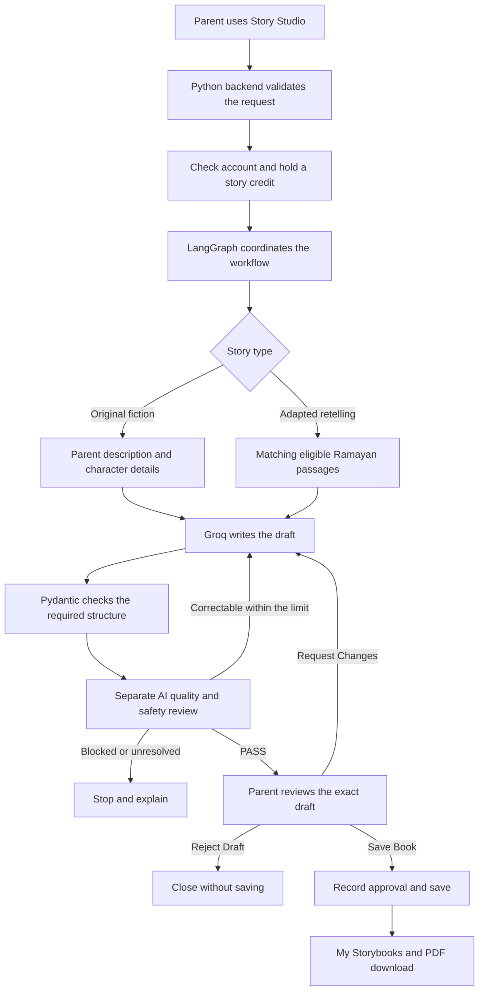

# Little Stories, Big Values

### Little stories for big feelings.

## App Overview

Little Stories, Big Values is a parent-guided AI storytelling app for families with children aged 3–8. It helps parents create gentle English stories about values such as kindness, sharing, patience and honesty for developing emotional intelligence (EQ). It helps parents prepare personalized stories for children aged 3–8, turning everyday moments into opportunities for shared reading and conversations about values.

Parents can choose between:

- **Original teaching-inspired fiction:** Create an imagined story from a description, using their own characters or an available character.
- **Adapted retelling:** Create a child-friendly adaptation of a supported Ramayan episode using source passages.

**Child - Friendly Story Adaptation:**  Avoids violent, frightening and harmful content while preserving the meaning of supported source stories. Independent quality and safety checks run before parent review.

Parents review the story before saving it. Saved stories appear in **My Storybooks** and can be downloaded as a text-only PDF.

The current app runs locally. Broader AI quality evaluation is still pending.

[Local setup and private source prerequisites](docs/SETUP.md) · [Security and publication boundaries](SECURITY.md)

## Problem Statement

Finding or rewriting a story that matches a child's age, interests and mood can take time. Parents may also want it to demonstrate kindness, sharing or patience—or explain a cultural story without changing its meaning.

Cultural stories need additional care. Simplifying a traditional episode should preserve its meaning, while newly imagined events should be clearly identified as fiction. A fluent AI response alone does not establish that a story is accurate or appropriate.

## Our Solution

### Where an AI Agent Can Help

The AI helps create a story from the parent's description or adapt a supported source passage. A separate reviewer checks the draft against the request and content rules. The parent keeps the final decision: request changes, save the story or reject it.

The goal is to reduce preparation effort and provide a starting point for meaningful shared reading.

The app brings story creation, automatic checks and parent review into one workflow:

1. **Choose preferences:** Select a child profile, story type, value and mood. Add an idea and any topics to avoid.
2. **Prepare the story context:** Original fiction uses the parent's description. Adaptations use matching passages from the supported Ramayan catalogue.
3. **Write the story:** The AI creates a connected six-page text draft.
4. **Review automatically:** A separate AI reviewer checks the draft against the request, quality rules and child-safety requirements. Correctable issues can return to the writer within a bounded correction limit.
5. **Let the parent decide:** After the required checks pass, the parent can **Save Book**, **Request Changes** or **Reject Draft**.
6. **Keep the approved version:** Saving adds the story to the library and enables PDF download. Changes require fresh checks and approval.

### Who It Serves

The primary persona is a **parent or caregiver creating stories for a child aged 3–8**. The adult operates the app; the child joins the reading experience.

| Audience | Main need | Current or future role |
|---|---|---|
| **Parents and caregivers** | Create suitable stories, review them and read together | Current primary users and potential buyers |
| **Children aged 3–8** | Enjoy stories, imagine and discuss feelings and values | Current reading participants; parent-guided |
| **Grandparents** | Share stories and cultural connections | Can join the current caregiver-led experience |
| **Teachers and schools** | Support classroom reading and values discussions | Future audience; dedicated tools needed |
| **Aftercare and childcare providers** | Prepare stories for small-group reading | Future audience |
| **Children’s content creators** | Prepare original scripts and printables | Future audience; publishing rights and workflows needed |
| **Libraries and cultural centres** | Offer intergenerational and culturally relevant reading | Potential community partners |
| **Bilingual families** | Read in their preferred languages | Future language expansion; Hindi is not enabled |

#### Product Priority

Establish usefulness for families first. Then validate educator, community and creator needs before building dedicated experiences.

*Future audiences are opportunities—not confirmed customers or partnerships.*

### Key Storytelling Features

**Create → Check → Parent Review → Save & Read Together**

| Feature | Why it matters |
|---|---|
| **Two Story-Creation Modes** | Create original fiction from a parent’s description or adapt a supported Ramayan episode. |
| **Values Through Storytelling** | Explore kindness, sharing, patience and honesty through relatable characters and actions. Available values depend on the story mode. |
| **Age and Mood Personalisation** | Match the request to the child’s age and choose calm bedtime or gentle daytime storytelling. |
| **Topics to Avoid** | Specify additional subjects the parent does not want included. |
| **Independent Quality and Safety Review** | Check the draft separately from writing before offering it for parent approval. Automated checks are not a safety guarantee. |
| **Clear Story Classification** | Distinguish imagined stories from source-based adaptations, with source notes where applicable. |
| **Parent Discussion Question** | Give families a starting point for talking about the story’s choices and values. |
| **Read Together or Print** | Save approved stories and download PDFs for reading away from the screen. |
| **Approval of the Exact Version** | Require fresh checks and approval after edits before the revised story can be exported. |

### Future Enhancements

Narration, Hindi stories, illustrated books using reviewed scene assets, sharing on social media and broader document retrieval remain future enhancements for the current parent-facing flow. Runtime AI image generation.

Story App - 

### Parent and Family Profiles

A family space where parents manage child profiles, personalise stories and keep their favourite books.

| Feature | Description |
|---|---|
| **Registration and Sign-In** | Create a parent account and access the family’s stories. |
| **Parent Profile** | View and update the parent’s name and optional email address. |
| **Child Profile Setup** | Add a child’s name and age to personalise story requests. |
| **Multiple Child Profiles** | Maintain separate reader profiles for children in the family. |
| **Reader Selection** | Select a child and apply their age to the story request. |
| **Edit or Delete Child Profile** | Update or remove a child’s profile while keeping saved books available. |
| **Story Preferences** | Choose the story type, characters, learning value, mood and topics to avoid. |
| **Parent Review** | Review the draft, request changes, save it or reject it. |
| **Family Story Library** | Reopen approved stories and download their PDFs. |
| **Story Credits** | View starter credits and simulated weekly-pass availability. |
| **Account Security** | Change the password and optionally create a one-time recovery code. |

### Admin Dashboard and Business Analytics

The dashboard helps explain how the product could monitor usage, reading activity and business performance.

| Dashboard area | What it shows |
|---|---|
| **Overview** | Account activity, story completion, credit usage and simulated business totals |
| **Parent Profiles** | Browser-local account summaries and related activity |
| **Story Analytics** | Story categories, characters, completion patterns and reading activity |
| **User Activity** | A timeline of captured local actions, such as opening a story or selecting a page |
| **Conversion Funnel** | Movement from account creation to story use and simulated checkout |
| **Payments and Credits** | Simulated weekly-pass purchases, successes, failures and credit consumption |
| **AI Operations** | Illustrative agent activity, status, duration, retries and cost information |
| **Retention** | Return-activity summaries when enough observation time is available |
| **Analytics Settings** | Local event-capture controls and visibility settings |

The interface supports date filters, data-source selection and CSV report downloads. Reports distinguish simulated historical records from captured browser-local activity.

**Current limitation:** These dashboard figures are not verified live customer metrics, real revenue or live AI-quality results. The dashboard is not yet connected to the protected backend summary.

Admin Dashboard and Business Analytics - 

### Current Scope

| Option | Available now |
|---|---|
| Story types | Original teaching-inspired fiction; Adapted retelling |
| Original-story values | Kindness, Sharing, Patience, Honesty |
| Adaptation values | Kindness, Sharing |
| Language | English |
| Mood | Calm bedtime; Gentle daytime |
| Duration | Three-minute target; actual stories may be shorter |
| Output | Six-page text story, saved library entry and approved PDF |
| Ramayan coverage | Rama welcoming Guha; Rama meeting Hanuman with Lakshmana |

The current flow does not provide unrestricted search across the Ramayan, new parent-uploaded sources, narration, Hindi stories or illustrated book output. Runtime AI image generation is excluded.

## Architecture

### Main Components

| Component | What it does |
|---|---|
| **HTML, CSS and JavaScript** | Display the parent screens, preferences, progress and story review |
| **Python backend** | Handles requests, account access, story credits and saved books |
| **LangGraph** | Coordinates writing, review, corrections and the approval checkpoint |
| **Pydantic** | Checks required fields, data structure and version references |
| **Groq** | Runs the story writer and a separate reviewer prompt/call in the current flow |
| **Local source retrieval** | Selects supported Ramayan passages and preserves page references |
| **SQLite and local files** | Store accounts, requests, drafts, source evidence and approved versions |
| **PDF renderer** | Creates a printable document from the approved text |

### How Source Retrieval Works

For an adapted retelling, the app selects a matching episode from its limited local catalogue. It supplies the saved passages and page references to the writer, then checks the resulting draft against that evidence. This is **Retrieval-Augmented Generation (RAG)**: providing relevant source material before asking the AI to write.

Original fiction skips Ramayan retrieval. Imagined events are labeled as fiction and must not be presented as scripture or supported by invented citations. Automated source checks are separate from qualified human cultural review.

### Where LlamaParse and LlamaIndex Fit

LlamaParse can read document text and layout. LlamaIndex can organise the resulting passages and coordinate retrieval, with LlamaCloud providing managed indexing and search services. These are part of the planned retrieval expansion; they are not the active source-retrieval path in the current parent journey.

### Parent Control

The AI writes and reviews content. Application rules enforce account ownership, credit limits and approval. An automatic QA result does not replace the parent's decision, and PDF export must use the same approved story version.

**Built by:** Akansha Kapoor · Team 6
