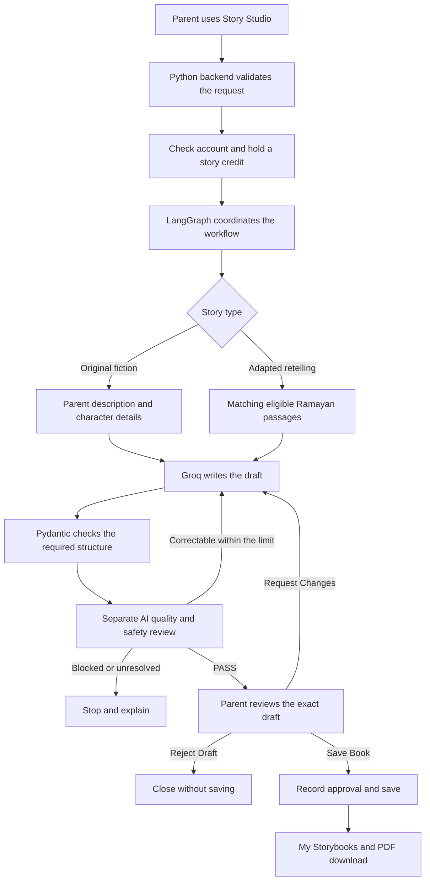

# Little Stories, Big Values

### Little stories for big feelings.

## App Overview

Little Stories, Big Values is a parent-guided AI storytelling app for families with children aged 3–8. It helps parents create gentle English stories about values such as kindness, sharing, patience and honesty.

Parents can choose between:

- **Original teaching-inspired fiction:** Create an imagined story from a description, using their own characters or an available character.
- **Adapted retelling:** Create a child-friendly adaptation of a supported Ramayan episode using source passages.

Parents review the story before saving it. Saved stories appear in **My Storybooks** and can be downloaded as a text-only PDF.

The current app runs locally. Broader AI quality evaluation is still pending.

[Local setup and private source prerequisites](docs/SETUP.md) · [Security and publication boundaries](SECURITY.md)

## Problem Statement

Finding a story that fits a child's age, interests and mood can take time. Parents may also want the story to explain a value through simple, relatable actions.

Cultural stories need additional care. Simplifying a traditional episode should preserve its meaning, while newly imagined events should be clearly identified as fiction. A fluent AI response alone does not establish that a story is accurate or appropriate.

## Our Solution

The app brings story creation, automatic checks and parent review into one workflow:

1. **Choose preferences:** Select a child profile, story type, value and mood. Add an idea and any topics to avoid.
2. **Prepare the story context:** Original fiction uses the parent's description. Adaptations use matching passages from the supported Ramayan catalogue.
3. **Write the story:** The AI creates a connected six-page text draft.
4. **Review automatically:** A separate AI reviewer checks the draft against the request, quality rules and child-safety requirements. Correctable issues can return to the writer within a bounded correction limit.
5. **Let the parent decide:** After the required checks pass, the parent can **Save Book**, **Request Changes** or **Reject Draft**.
6. **Keep the approved version:** Saving adds the story to the library and enables PDF download. Changes require fresh checks and approval.

### Current Scope

| Option | Available now |
|---|---|
| Story types | Original teaching-inspired fiction; Adapted retelling |
| Original-story values | Kindness, Sharing, Patience, Honesty |
| Adaptation values | Kindness, Sharing |
| Language | English |
| Mood | Calm bedtime; Gentle daytime |
| Duration | Three-minute target; actual stories may be shorter |
| Output | Six-page text story, saved library entry and approved PDF |
| Ramayan coverage | Rama welcoming Guha; Rama meeting Hanuman with Lakshmana |

The current flow does not provide unrestricted search across the Ramayan, new parent-uploaded sources, narration, Hindi stories or illustrated book output. Runtime AI image generation is excluded.

## Architecture

### Main Components

| Component | What it does |
|---|---|
| **HTML, CSS and JavaScript** | Display the parent screens, preferences, progress and story review |
| **Python backend** | Handles requests, account access, story credits and saved books |
| **LangGraph** | Coordinates writing, review, corrections and the approval checkpoint |
| **Pydantic** | Checks required fields, data structure and version references |
| **Groq** | Runs the story writer and a separate reviewer prompt/call in the current flow |
| **Local source retrieval** | Selects supported Ramayan passages and preserves page references |
| **SQLite and local files** | Store accounts, requests, drafts, source evidence and approved versions |
| **PDF renderer** | Creates a printable document from the approved text |

### How Source Retrieval Works

For an adapted retelling, the app selects a matching episode from its limited local catalogue. It supplies the saved passages and page references to the writer, then checks the resulting draft against that evidence. This is **Retrieval-Augmented Generation (RAG)**: providing relevant source material before asking the AI to write.

Original fiction skips Ramayan retrieval. Imagined events are labeled as fiction and must not be presented as scripture or supported by invented citations. Automated source checks are separate from qualified human cultural review.

### Where LlamaParse and LlamaIndex Fit

LlamaParse can read document text and layout. LlamaIndex can organise the resulting passages and coordinate retrieval, with LlamaCloud providing managed indexing and search services. These are part of the planned retrieval expansion; they are not the active source-retrieval path in the current parent journey.

### Parent Control

The AI writes and reviews content. Application rules enforce account ownership, credit limits and approval. An automatic QA result does not replace the parent's decision, and PDF export must use the same approved story version.

**Built by:** Akansha Kapoor · Team 6
