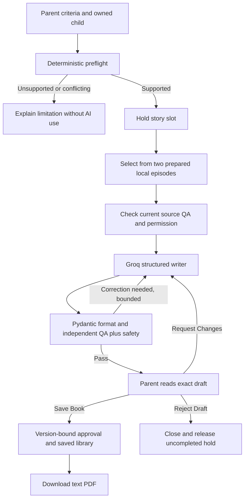

# Current release register — 6 November 2026

This register distinguishes the running app from proposed and historical capabilities. Main documents link here; previous editions are preserved in `history/2026-11-06-gap-repairs/`.

## Open and use

- Local app: http://localhost:8003/index.html. Start with `.venv\Scripts\python.exe -m backend.ramayan_live_server --port 8003`.
- Sign in / My account is the single account entry; the reader badge identifies the selected child. Accounts require a 12–128 character password.
- Parent account opens at http://localhost:8003/account.html. The main app's account entry is a prominent button in the persistent header, including on My Storybooks. It stays available when the account-status request fails; no separate Account tab is needed.
- My account includes Parent profile: name, optional email, sign-in login and actual account creation date. Existing accounts have no invented name/email; save them using the profile form. My Storybooks includes collapsed Parent account details with an edit link. Email is unverified, sends no messages and does not change the sign-in login. The server stores the profile privately under the authenticated account.
- Create a child profile and choose a story mode. Original teaching-inspired fiction uses a required parent description and characters from that description (or a selected character), without Ramayan retrieval. It supports Kindness, Sharing, Patience and Honesty. Adapted retelling uses Rama/Hanuman and the limited Ramayan episodes below. Both modes currently use English and a three-minute target; the selected age must match the profile.
- Supported passages: Rama's welcome with Guha (PDF 549–551), and Rama meeting Hanuman (PDF 1178–1180 and 1185). This is not unrestricted search across the full book.
- Studio explains mode-specific unavailable choices next to the preferences. Original fiction is now selectable and enables all four displayed character cards plus characters from the parent?s description. Traditional retelling remains unavailable. Guha and Lakshmana, when explicitly named in a matching episode request, are preserved through startup validation. Invalid story fields, expired sign-in and unavailable credits now have specific messages; a definitive rejected request does not retain a conflicting retry key. Browser-only sample friends are hidden in this Ramayan journey.
- In the adaptation path, unsupported topics, unknown names and contradictory character exclusions stop before generation. The conservative vocabulary check can reject valid paraphrases; it never claims broad semantic understanding.
- Read the six-page draft. Only passing QA permits Save Book / Request Changes / Reject Draft. Saving approves the exact script, places it in My Storybooks and enables PDF. A critical safety failure hides the draft. Other incomplete drafts may be inspected but cannot be saved/exported.

## What triggers what

## Policy and implementation

| Area | Current rule and evidence boundary |
|---|---|
| Story pages | Six paragraphs; at least 25 words each and 180 total child-facing words including reflection; duplicate full-page text rejected. These checks supplement model QA, not measured engagement. |
| Source review | Internal automated source QA plus separate draft review. Records say automated_qa, never qualified human certification. Edition metadata remains unverified; private-use permission is not a public redistribution licence. |
| Review | Five dimensions plus critical safety must all pass; FAIL/PENDING cannot authorize output. At most two automatic correction cycles. No weakening of safety or evidence checks in this repair. |
| Approval | Parent approves the exact story text by saving. Changed text requires new QA and approval. The text edition needs no scene pictures. Illustrated workflows still require reviewed static scenes and application checks; no runtime image generation. |
| Providers | Shared Groq/Nebius abstraction exists. The active local path fixes Groq; reviewer temperature 0.5, writer 0.2. Both accounts' readiness is not certified by offline tests. |
| Retrieval | Local prepared passages are live in this lane. LlamaParse + LlamaCloud managed indexing/retrieval is the selected expansion direction, replacing Pinecone. BGE/BM25/RRF/FlashRank and Pinecone adapters elsewhere do not imply connected live full-book search. |
| Credits | Three starter stories; then simulated $5/week for up to ten stories, seven days, no automatic renewal. Hold before AI, consume once on completion; release uncompleted holds on failure/cancel. No payment capture or real transactions. |
| Usage | Default 30 logical operations/account/UTC day and six/run. These are not a dollar budget. Authenticated operation-usage API returns next UTC midnight. Already submitted provider work can cost credits even after cancellation. |
| Account | Server-backed profiles, child add/edit/delete, owner isolation, sign-out, credits, library and billing history. Password changes revoke sessions and recovery codes. Recovery uses a previously saved one-time code, not email. Child deletion retains history; full account erasure remains unfinished. |
| UI | One account entry, explicit supported choices, terminal failure headings, cancel control during working states, future festival generation gated before legacy API calls. Sharing controls do not publish. |
| Assets | Rama selection artwork remains browser-local unless separately deployed. Selection artwork is not automatically an approved page scene. |
| Future scope | Hindi, narration, actual social sharing, broader retrieved episodes, shared asset publication, full account lifecycle, production admin telemetry and remote hosting. |

## Validation and remaining risks

See [gap repair verification](verification/application-gap-repairs-2026-11-06.md) for actual test results. Offline checks do not establish new live generation success or measured cultural accuracy. No paid calls or held story-evaluation dataset execution were made in this repair.

Next increment: startup has a read-only `--check` and refuses automatic paid source-QA creation. Account settings include password change and one-time-code recovery. Recent requests can reopen an existing run; explicit continuation is offered only with compatible settings, a valid story hold and no uncertain operation. In-process duplicate submissions are suppressed per revision; this is not a production distributed job queue.

HHH foundation: twelve new isolated technical cases use the current account-backed text-only assembly with MockTransport providers. All workflow checks passed; all real-content HHH verdicts remain PENDING. No held STORY dataset or paid model was executed. See `evaluation/hhh_v1/README.txt` and `docs/verification/hhh-offline-2026-11-06-r3/summary.json`. Independent model/human calibration, live budgeted evaluation and RAGAS are still pending.

Remaining priority: measured broader retrieval; uncertain-provider reconciliation and production-grade recovery; full account erasure; shared authorised artwork; authorised content-quality evaluation. LlamaCloud indexing is not claimed as complete. Localhost serves only the local computer.

## Original fiction increment

Originals use a separate compact writer/reviewer prompt with no source quotes. The application supplies the exact fiction disclosure; any factual claims still need appropriate support or removal. The same account credit hold, independent QA, bounded corrections, parent Save Book / Request Changes / Reject Draft, version checks, library and text PDF gates apply. Images and narration are not added. A new check ran the actual UI/HTTP/graph/PDF with controlled model responses: see `verification/original-fiction-browser-2026-11-06.json`. This is not a live quality judgment or a completed HHH/RAGAS evaluation. Current server startup still verifies its existing Ramayan workspace, but an original request does not retrieve from it.
