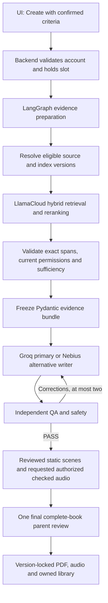

> Current-runtime authority: [current release register](current-release-status.md), updated 6 November 2026. This document retains its stage-specific design/history; integrations and test counts below apply to that recorded scope, not automatically to the running app.

# LlamaParse and LlamaCloud managed retrieval plan

**Current source-review clarification (November 5, 2026): the internal QA agent performs source checks and a separate exact-draft review. A supported automated source-QA PASS may establish content eligibility under the configured application policy; it is stored as automated_qa, never as qualified human review. Usage rights remain separately authorized. Parents do not approve source passages or need backend access. Only after all draft QA/safety checks pass do they see Approve Book / Request Changes / Reject. PDF remains the first-delivery output; narration is deferred. Historical human-review-only requirements below are superseded for this automated path.**

**First-delivery scope (November 5, 2026): story creation -> QA -> Approve Book / Request Changes / Reject -> PDF download. ElevenLabs/narration is deferred. PDF-only v5 rejects narration requests and hides unavailable voice controls. Source eligibility, safety and reviewed static-scene requirements remain. The narration-after-approval design below applies when narration is enabled in a later release.**

## Latest workflow authority - November 5, 2026

Current target: **parent criteria -> eligible episode retrieval -> configurable top-k ranking -> faithful child-friendly adaptation -> independent QA -> parent review -> approved-script narration -> authorized outputs**. Parent actions remain **Approve Book / Request Changes / Reject**; do not add a Choose another story button. Parent need not choose an episode. Automated screening, QA and parent approval never count as qualified human source review.

**Implementation boundary:** episode selection and bounded next-candidate recovery are connected to the persistent v5 graph via a trusted EpisodePlanner provider interface and verified with synthetic evidence. A real Ramayan episode provider and reviewed/indexed corpus remain unconfigured. Approval-before-narration is implemented as an explicit v5 account graph/API option, with capability-gated UI wording; running-server rollout remains pending. Existing v4 can still prepare requested audio before final review and must not be represented as compliant with v5. Preserve old runs under their original policy and introduce an explicit versioned migration. [Detailed target and acceptance gates](criteria-driven-story-selection.md).

Decision: November 5, 2026. Authority: [current decisions](CURRENT_DECISIONS.md).

## Selected architecture and status

Use LlamaParse for document extraction and LlamaCloud managed indexing/retrieval instead of Pinecone. LlamaParse alone is not a vector database. The hosted index organizes passages, creates embeddings and provides hybrid search with optional reranking. Live project access, parser execution on one original sample page and read-only Index inventory have been verified. The parse billed 3 credits; 997 remain of the authorized verification allowance. Live index publication and actual Ramayan retrieval quality remain pending.

The local LlamaIndex Python framework is optional: hosted REST APIs can reuse existing httpx. No umbrella SDK, local core package or extra model download is required merely to access hosted retrieval. Select SDK versus REST only after verifying the account API generation and Python compatibility. A project ID is not an index ID. Do not assume the user's existing project uses Index v2.

## Components and impact

| Component | Current code | Target role |
|---|---|---|
| Local extraction and source workspace | Exists with actual PDF audit | Preserve originals/audit; compare hosted extraction, never silently overwrite |
| LlamaParse | Adapter implemented; one-page live verification passed | Parse permitted documents; preserve page/edition mapping |
| LlamaCloud managed index | Adapter implemented; live Index inventory passed, zero indexes | Chunk, embed, hybrid search and rerank eligible material |
| Pinecone adapter | Offline-tested | Superseded cloud choice; retain code/history, no provisioning |
| Local BGE/BM25/RRF/FlashRank | Existing baseline | Optional comparative experiments, not mandatory hosted stages |
| LangGraph | Existing opt-in workflow | Keep coordination, corrections, checkpoint recovery and final review |
| Pydantic | Existing evidence/book contracts | Validate hosted results and immutable version references; not cultural truth |
| UI | Existing Studio and opt-in managed view | Preserve screens and Approve Book / Request Changes / Reject; approve exact script before narration |

Do not call hosted full-text retrieval identical to local BM25/RRF or assume the hosted embedding/reranker is BGE/FlashRank. Verify actual settings and supported metadata filters.

## Document preparation: once per source version

Upload validation -> permitted LlamaParse processing -> extraction/page checks -> qualified source eligibility review -> index eligible passages -> verify publication -> activate an immutable local index manifest. Parsing is not approval. Rights to parse/store source text in LlamaCloud are separate from model-provider permissions; previous vector-only Pinecone permission does not cover raw-text cloud processing.

A service may combine parsing, chunking and indexing automatically. Do not auto-publish an unreviewed full book to the eligible story index. Use an isolated restricted staging area only when authorized; the searchable story corpus must exclude ineligible passages before search and reranking. If supported configuration cannot enforce passage eligibility, build separate eligible inputs/indexes or block activation. Result filtering after retrieval alone is insufficient.

Preserve original source ID, title, edition, PDF/printed page mapping when available, section, local content hash, parse version, review/rights records, owner scope, hosted file/chunk IDs and local immutable index-manifest ID. Missing or ambiguous page mappings stay unresolved, never invented. Hosted updates must not silently change a frozen evidence bundle.

The existing 300-word/50-overlap local chunker and BGE token audit remain baseline evidence, not selected hosted settings. Evaluate hosted chunking against episode boundaries, complete character context, accurate page spans, answer coverage and truncation. Start with a permitted small sample; full 1,960-page processing requires an explicit allowance. Inspect the four no-text pages before assuming OCR is required.

## Story request: every creation

UI receives a run ID and polls authorized saved status. Parsing is not repeated for each request. Insufficient evidence blocks a traditional retelling; no silent provider switch, fictional relabeling or source substitution. Pydantic maps hosted results into existing SourceReference/RankedPassage/EvidenceBundle contracts. Recheck revocation before writing and output. Returned relevance scores do not grant evidence sufficiency.

## Smallest safe implementation increments

1. Confirm API version, account permissions, region, index identifier, quota and approved spend; secrets stay server-side. No keys in browser, documents or traces.
2. Add proposed backend/ingestion/llamaparse.py and backend/retrieval/llamacloud.py adapters using existing transport where feasible; keep feature disabled by default.
3. Validate mocked parse/search responses, malformed metadata, timeouts, authorization failures, cross-owner access and source-version mismatches. Never silently fall back to an unqualified corpus.
4. Add durable parse/index jobs, idempotency and bounded retries. Unknown outcomes require reconciliation before retrying potentially chargeable work.
5. Preserve source authority in the application; wire the adapter at backend/accounts/assembly.py evidence_resolver. Pydantic schema extensions require their own tests; this documentation makes none.
6. Run a separately authorized small-source extraction/publication/retrieval check. Compare existing baseline and hosted retrieval on identical labeled questions; exact score/rank parity is not required because engines differ.
7. Measure reference accuracy, retrieval Recall@K, exact-name/meaning matching, no-answer behavior, eligibility leakage (zero), latency and actual usage. Keep held story-evaluation datasets untouched.
8. Connect the existing Studio and verify one actual book end to end, including images, requested narration and approval hashes. Only then claim live readiness.

## Boundaries preserved

English only; approved static scene assets only; no runtime image generation. Three free stories then simulated $5/week for up to ten stories. No live payments. Groq primary with bounded Nebius fallback only for eligible availability failures; never for missing evidence, authorization or safety refusals. Parent selects once and reviews the complete requested book once. Credits, eligibility, asset permissions and version approvals remain deterministic application controls.

No service calls, dependency installation, source approval, application restart or evaluation execution is authorized by this documentation update. Previous 382-test results are historical application evidence, not LlamaCloud integration verification.

## Official technical references

- [Managed indexing](https://developers.llamaindex.ai/llamaparse/cloud-index-v2/getting_started/)
- [Hybrid retrieval, filtering and reranking](https://developers.llamaindex.ai/llamaparse/cloud-index-v2/retrieval/)
- [API-generation migration](https://developers.llamaindex.ai/llamaparse/cloud-index-v2/migration-v1-to-v2/)

The earlier local-adapter-only proposal is superseded by this hosted-service design. Existing dependency files remain unchanged.

## Hosted retrieval implementation increment 1 - November 5, 2026

Configuration and internal Pydantic contracts are now implemented with offline tests. Hosted parsing/index/search transports and evidence-resolver wiring remain unimplemented; API access and actual-book retrieval remain unverified. No service activation or paid calls. [Changes and verification](hosted-retrieval-stage1.md).

## LlamaParse adapter increment 2 - November 5, 2026

The opt-in LlamaParse v2 adapter and durable owner-scoped job journal now exist and pass offline fixtures. It validates source bytes/pages, prevents uncertain POST resubmission and normalizes complete extraction. It is not connected to the running app. Source permission/qualified review integration, managed-index publication/search and evidence-resolver wiring remain pending. No live upload or paid call. Verification: 203 tests run, 202 passed, one optional real-PDF check skipped; zero failures/errors. [Implementation and limits](llamaparse-stage2.md).

## Hosted source-review increment 3 - November 5, 2026

Hosted source review increment 3 now provides backend-only, offline-tested processing grants, independent usage-policy checks, owned extraction capture, exact-span qualifications, separate inspiration/traditional purposes and revocation-aware eligible manifests. Existing parent workspace records are unchanged. Real qualified Ramayan review, privileged policy/UI wiring, live budget accounting, hosted indexing/retrieval and evidence-resolver connection remain pending. No live requests or actual source approvals. Regression: 227 run, 226 passed, one optional real-PDF rendering skip; zero failures/errors. [Implementation and verification](hosted-source-review-stage3.md).

## Managed publication increment 4 - November 5, 2026

Index v2 publication is now implemented as an opt-in offline-tested adapter: stage only current qualified text passages, create a separate candidate directory/index, verify complete file/provenance coverage and exact parsed text, then explicitly activate a local version pointer. Saved verification has an integrity hash; current eligibility and indexing authorization are rechecked. Initial sample limit: 20 passages. Directory-list shape, parsed metadata propagation and exact preservation still require live account verification. No running-app integration, real publication, search or paid calls. Final regression: 248 run, 247 passed, one optional real-PDF rendering skip; zero failures/errors. [Implementation and verification](hosted-publication-stage4.md).

## Hosted hybrid search increment 5 - November 5, 2026

Hosted hybrid search is now implemented offline: fresh remote index/file checks, eligible-file and metadata filters before reranking, exact returned-text mapping, reviewed-parent expansion, original PDF references, actual-token-counter injection, durable query identity and saved-result checks. Source sufficiency remains PENDING; no EvidenceBundle or writer call is automatically created. Defaults are uncalibrated and live account/actual-book quality remain unverified. No UI/server activation, live service calls or held evaluation run. Final regression: 273 tests run, 272 passed, one optional real-PDF rendering skip; zero failures/errors. [Implementation and verification](hosted-search-stage5.md).

## Hosted evidence resolver increment 6 - November 5, 2026

Hosted evidence resolver and explicit account assembly now exist offline. Confirmed requests, selected sources, characters, current search selections and separately supplied sufficiency assessments are bound together. Only a supported PASS freezes an existing EvidenceBundle; default assessment is PENDING and blocks the writer. Hosted prepared evidence skips legacy dense/sparse nodes without inventing their scores; the legacy route remains. Saved bundles recheck permissions, policy and remote index state. Final regression: 349 tests run, 347 passed, two optional browser-PDF checks skipped; zero failures/errors. Default app startup, real source qualification, live assessor/API readiness and full hosted-account book acceptance remain pending. No paid calls or held evaluation runs. [Implementation and verification](hosted-resolver-stage6.md).

## Authenticated hosted backend increment 7 - November 5, 2026

Authenticated hosted-source endpoints and bounded durable background tasks are now implemented offline. Existing account sessions/CSRF/role checks protect owned upload/status/parse/resume and privileged permission/qualification/publication/activation/withdrawal actions. GET status does not trigger provider calls; queues, duplicate request keys and recovery retain adapter safeguards. Parsing does not spend story credits. Final broader regression: 399 tests run, 396 passed, three optional browser-PDF skips; zero failures/errors. The 17 new HTTP tests also passed independently after isolating server test-data initialization. Default server startup and running UI remain unchanged; no live service call, actual source qualification, account provisioning or held evaluation execution. [Implementation and verification](hosted-backend-stage7.md).

## Explicit hosted application increment 8 - November 5, 2026

Explicit hosted application composition and an account-owned active-source catalog are now implemented offline. The factory joins workspace, policies, parser/publication/search/resolver, bounded source jobs and the existing complete-book account API; checks actual child ownership and binds query hashes to saved owned runs. Configured mode requires explicit opt-in and mock transports for synthetic execution. Read-only catalog/readiness endpoints expose no credentials and make no provider requests. The actual HTTP fixture covers source preparation through writer/QA, reviewed static scenes, one final book approval, saved HTML/library and exactly one completion debit. Final regression: 410 tests run, 407 passed, three optional browser-PDF skips; zero failures/errors. No live calls, actual cultural qualification, running-server attachment or held evaluation run. Legacy Studio source controls still need the new catalog/progress hook before UI rollout. [Implementation and verification](hosted-application-stage8.md).

## Hosted Sources and Studio increment 9 ? November 5, 2026

The existing Sources and Studio controls now support the opt-in composed hosted backend: account-owned PDF upload, saved preparation progress and eligible catalog selection, rechecked before submission. Hosted mode hides legacy parent source approval and disables unsupported web links; legacy mode remains. Offline browser checks cover upload through one complete-book approval and exactly one completion debit. The backend suite ran 410 tests: 407 passed, three optional PDF checks skipped, zero failures/errors. No paid calls, held evaluations or running-server changes. Live source qualification, retrieval quality and service readiness remain unverified. [Details](hosted-ui-stage9.md).

## Live parser verification increment 11 - November 5, 2026

One original technical PDF page was parsed live through the existing durable adapter using cost_effective version 2026-10-30. Page/hash validation and expected text checks passed; 236 characters extracted. Parser regression: 20 tests passed. User authorized 1,000 credits; actual charge remains unreported by the usage response, so the local 100-credit reservation is unreconciled and further paid work is held. Known organization/project/v2 settings were added without enabling global rollout. Index publication, approved-source eligibility, Ramayan retrieval and generation remain unverified. [Details](hosted-live-parse-stage11.md).

## Credit reconciliation increment 12 - November 5, 2026

Corrected Parse usage lookup to job.usage.credits. The existing live sample cost 3 credits; 997 remain from the authorized 1,000-credit verification allowance (not the account balance). Live Index inventory returned HTTP 200 and zero indexes. No new uploads or index creation. Five usage tests plus parser/publication regressions passed: 46 total. Qualified source review and isolated live publication remain pending. [Details](hosted-credit-reconciliation-stage12.md).
